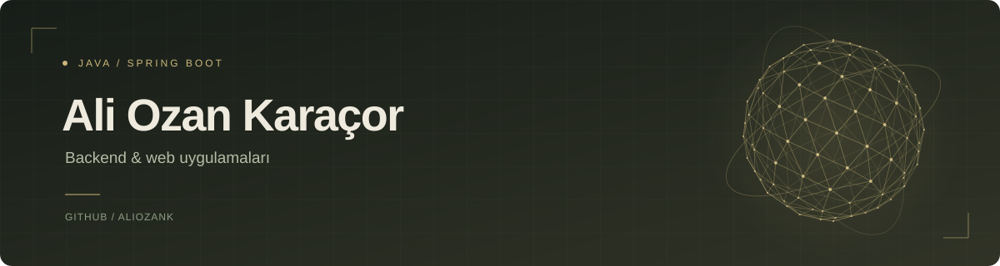

  
  

### Merhaba 👋

Java ve Spring Boot ile backend ve web uygulamaları geliştiriyorum. REST API’ler, kimlik doğrulama, servisler arası iletişim ve ilişkisel veritabanlarıyla çalışıyorum.

### Teknolojiler

**Backend**  
  

**Web**  
  

**Veritabanı & mesajlaşma**  
    

**Geliştirme & test**  
     

### Seçilmiş çalışmalar

| Proje | Kapsam | Teknolojiler |
| :--- | :--- | :--- |
| **[Flight Management System ↗](https://github.com/aliozank/Flight-Management-System)** | Uçuş operasyonları ve referans kayıtları için mikroservis tabanlı web uygulaması | Java · Spring Boot · Vue · Kafka |
| **[MatchLab ↗](https://aliozank.pages.dev/proje-matchlab)** | Maç, lig, canlı skor ve kullanıcı takibi için spor platformu | Java · Spring Boot · PostgreSQL · React |
| **[Payroll Engine ↗](https://aliozank.pages.dev/proje-payroll)** | Türkiye özel sektör 4/a bordro hesapları için veritabanı motoru | MSSQL · T-SQL · Saklı yordamlar |

Proje açıklamalarını ve mimari şemalarını **[portfolyomda inceleyebilirsiniz](https://aliozank.pages.dev/projeler)**.
